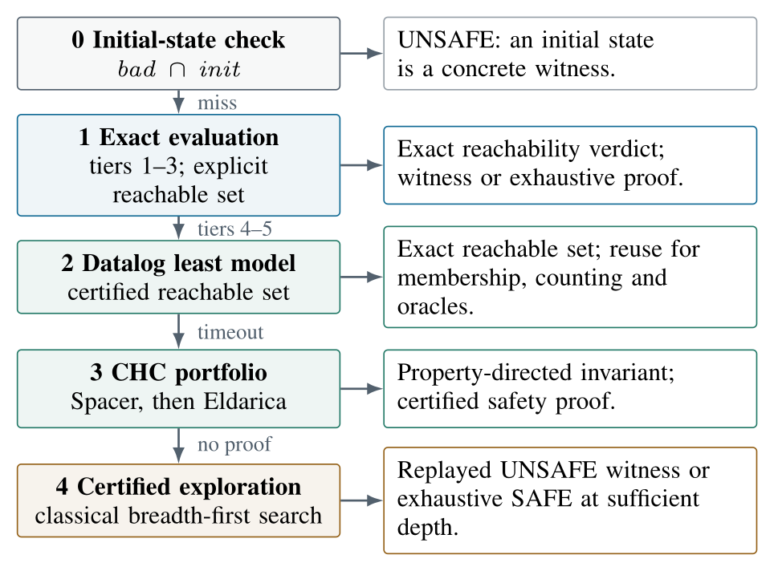
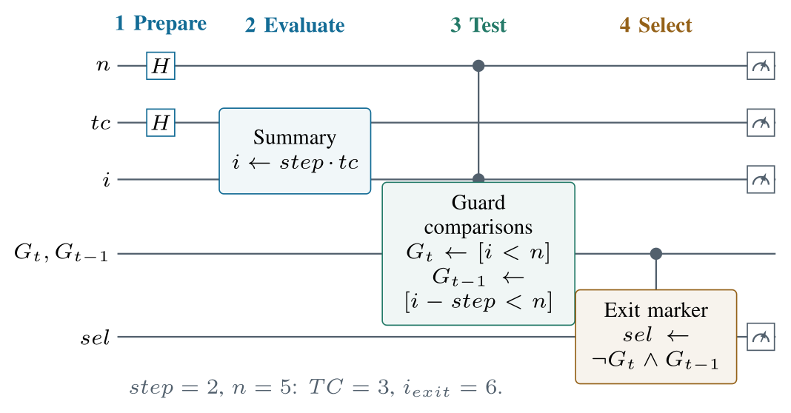
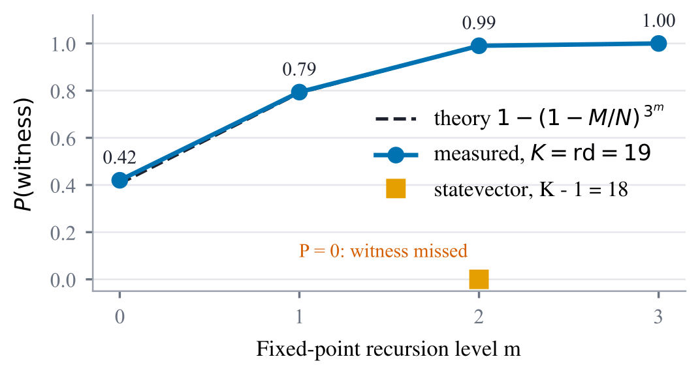
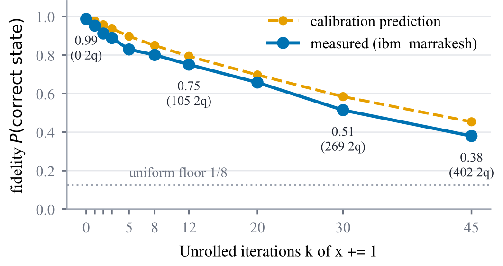

# Boucles certifiées pour l'exécution symbolique quantique

Analyser un programme, c'est savoir quelles valeurs il peut produire, sans l'exécuter sur toutes ses entrées. Les boucles sont le point faible des outils actuels : ils les déroulent un nombre de fois fixé à l'avance et ratent tout ce qui se passe après. Pendant mon stage de recherche à l'University of Waterloo, j'ai conçu une méthode qui **remplace cette limite devinée par une couverture prouvée**, et je l'ai implémentée avec des solveurs classiques et des circuits quantiques, jusqu'à un essai sur un vrai processeur IBM.

**Article de recherche (premier auteur)** : « Beyond Bounded Unrolling: Certified Loops for Quantum Symbolic Execution », Yanis Djelali et Meng Xu, 8 pages, format IEEE. [Lire l'article (PDF)](docs/Beyond_Bounded_Unrolling_Djelali_Xu_2026.pdf)

| | |
|---|---|
| Cadre | stage de recherche Mitacs Globalink, CrySP Lab, University of Waterloo (Canada) |
| Dates | juin à août 2026, 12 semaines |
| Encadrant | Pr Meng Xu |
| Mon rôle | premier auteur : conception de la méthode, implémentation, expériences, rédaction |
| Statut | soumis, en cours d'évaluation |
| Outils | Python, Qiskit (simulateurs Aer et MPS), IBM Quantum, Z3 (Spacer, Datalog µZ), Eldarica, Polar |

## Le problème : un bug qui n'apparaît qu'au 39e tour

Voici une boucle de l'article, sur des entiers de 5 bits (valeurs de 0 à 31, qui repartent à 0 quand elles débordent, comme dans un vrai processeur) :

```python
x = 1
i = 1
while x < 31:
    x = x * i      # x calcule une factorielle
    i = i + 1
```

À première vue, `x` grossit vite et la boucle s'arrête au bout de quelques tours. En réalité, au 8e tour, le produit déborde et `x` tombe à **0**. À partir de là, la condition `x < 31` reste vraie pour toujours : la boucle ne s'arrête plus. Le compteur `i` continue de tourner, dépasse 31, repart à 0, et l'état fautif `(i = 8, x = 0)` n'apparaît qu'au **39e tour**.

| | Outil classique (nombre de tours deviné) | Ma méthode (nombre de tours prouvé) |
|---|---|---|
| Nombre de tours explorés | 38, par exemple | 39, prouvé suffisant par un solveur SMT en 0,1 s |
| Verdict | « aucun problème trouvé » | **état fautif trouvé au tour 39**, puis rejoué pour confirmation |
| Garantie | aucune au-delà de 38 tours | tous les états atteignables sont couverts |

Un outil qui s'arrête à 38 tours conclut que le programme est sûr, alors qu'il ne l'est pas. Ce genre d'erreur a des conséquences réelles : c'est un dépassement de capacité d'un entier, non anticipé, qui a causé l'échec du premier vol d'Ariane 5 en 1996.

L'exécution symbolique quantique (QEX, IEEE QCE 2025) encode toutes les entrées du programme en superposition et les traite en une fois. Mais elle déroule les boucles un nombre fixe de fois, comme les outils classiques, et rate donc les mêmes cas. Sur notre corpus de 20 boucles, un déroulage à 2 tours omet **83 %** des valeurs de sortie d'une simple récurrence linéaire, et toutes celles de la boucle de Collatz.

## L'idée : regarder la structure de la boucle avant de choisir l'analyse

Chaque boucle est d'abord classée selon la forme de son corps :

| Niveau | Corps de la boucle | Ce qui est calculé |
|---|---|---|
| 1 | incréments constants (`i += 2`) | sortie exacte, par calcul matriciel |
| 2 | mises à jour linéaires couplées | sortie exacte, par calcul matriciel |
| 3 | accumulations (`x += i; i += 1`) | sortie exacte, formule polynomiale |
| 4 | opérations non linéaires (`x = x * i`) | ensemble atteignable, invariants, borne certifiée |
| 5 | branchements (`if x % 2 == 0 ...`) | ensemble atteignable, invariants, borne certifiée |

**Niveaux 1 à 3 : un résultat exact, même avec le débordement des entiers.** Le corps de la boucle est traduit automatiquement en matrice. Comme les entiers machine ont un nombre fini de valeurs, les puissances de cette matrice finissent forcément par se répéter. En calculant cette période, on obtient une borne qui couvre **toutes** les entrées, et on sait exactement quand la boucle s'arrête, ou qu'elle ne s'arrête jamais. Sur des entiers de 32 bits, la borne dépasse 15 milliards d'itérations, et elle est prouvée en 17 ms.

**Niveaux 4 et 5 : une chaîne de solveurs.** Chaque boucle passe par une suite d'analyses classiques, et la première qui donne un résultat prouvé l'emporte :

<p align="center"></p>

**La partie quantique.** Des circuits calculent directement le résumé de la boucle sur toutes les entrées en superposition, sans recopier son corps des dizaines de fois. Ils repèrent ensuite les entrées qui violent une propriété, amplifient ces cas pour les rendre faciles à mesurer (recherche de Grover à point fixe), et estiment combien il y en a (comptage quantique).

<p align="center"></p>
<p align="center"><sub>Circuit qui trouve la sortie de la boucle pour toutes les entrées à la fois : préparation, calcul du résumé, test de la condition, sélection de la sortie.</sub></p>

## Ce que j'ai construit

- L'**analyseur de sortie** automatique pour les niveaux 1 à 3 : du code source de la boucle à la matrice, puis au certificat de période valable malgré le débordement des entiers.
- Les **circuits quantiques de résumé** (affine et polynomial), et un compilateur qui transforme automatiquement le corps d'une boucle polynomiale en circuit.
- Les modules de **recherche de témoin** et de **comptage quantique**, branchés sur des invariants vérifiés.
- Le **calcul de la borne de déroulage certifiée**, par solveur SMT, pour les boucles qui n'ont pas de raccourci.
- Le **routeur classique** à 5 étapes et le banc d'évaluation : 20 boucles, 3 tailles d'entiers, référence calculée indépendamment.
- Une **campagne de mesures sur le processeur IBM** `ibm_marrakesh`.

## Résultats

| Mesure | Résultat |
|---|---|
| Valeurs de sortie oubliées sur le corpus (déroulage fixe à 2 tours : jusqu'à 100 %) | **0 %** |
| Verdicts du routeur conformes à la référence (20 boucles, 3, 4 et 5 bits) | **189 / 189** |
| Entrées vérifiées pour l'analyseur de sortie, dont 10 063 qui ne terminent pas | **939 968**, aucun écart |
| Témoin trouvé à la profondeur certifiée 39, manqué à 38 (circuit de 401 qubits) | **oui** |
| Comptage quantique : 12 états marqués parmi 64 | estimé à **12** |
| Instances décidées en combinant les deux solveurs d'invariants | **63 / 63** |

Chaque résultat est contrôlé de façon indépendante : un interpréteur séparé recalcule toutes les sorties, et des circuits volontairement faux sont rejetés par les tests.

**Profondeur certifiée contre profondeur devinée.** C'est la boucle factorielle du début, exécutée dans un circuit quantique de 401 qubits (simulé). Avec 39 tours, le circuit trouve l'état fautif. Avec 38, le même circuit ne trouve rien. Sa trace complète correspond exactement à l'ensemble des états atteignables calculé par ailleurs.

**Amplification.** La probabilité de mesurer un témoin passe de 0,42 à 0,99 en deux niveaux d'amplification, exactement comme le prévoit la théorie, sans que le circuit connaisse à l'avance le nombre de solutions. Avec un tour de moins que la borne certifiée, elle tombe à zéro (carré orange) :

<p align="center"></p>

**Deux solveurs complémentaires.** Spacer et Eldarica échouent sur des boucles différentes : 11 cas que Spacer ne résout pas en 30 s, Eldarica les résout en 0,9 s, et inversement. Combinés, ils décident les 63 instances. Mais Eldarica peut renvoyer des invariants très larges (jusqu'à 160 fois l'ensemble réel), c'est pourquoi le routeur utilise Datalog quand il faut compter exactement.

## Sur un vrai processeur quantique

J'ai exécuté une boucle `x += 1` déroulée jusqu'à 45 fois sur `ibm_marrakesh` (IBM Quantum, 13 août 2026, 4 096 mesures par point, sans correction d'erreurs). La fidélité passe de 0,99 à 0,38 après 45 itérations, soit 402 portes à deux qubits. Elle reste trois fois au-dessus du hasard, mais la pente est nette.

<p align="center"></p>

Conclusion : sur le matériel actuel, répéter le corps d'une boucle coûte cher en bruit. C'est ce qui justifie de calculer des résumés plutôt que de dérouler.

## Limites

- Les expériences sont menées sur de petites tailles d'entiers (3 à 5 bits), comme dans l'article QEX d'origine, pour pouvoir tout comparer à une référence exhaustive.
- Un avantage quantique pratique demanderait de construire les oracles à bas coût et des machines tolérantes aux fautes. L'article mesure la correction des circuits et leur coût en ressources, il ne revendique pas d'accélération.
- La synthèse quantique couvre les modèles implémentés (affine, polynomial, Collatz) ; la généralisation aux mises à jour linéaires quelconques est décrite comme une suite du travail.

## Pourquoi ce travail compte au-delà du quantique

Les briques classiques de ce projet (solveurs SMT, clauses de Horn, model checking borné, certification indépendante des résultats) sont celles qu'on utilise pour vérifier du logiciel critique. La méthode de travail est la même : ne jamais faire confiance à une borne devinée, prouver ce qu'on affirme, et contrôler chaque résultat par un deuxième moyen.

## In English

*Quantum symbolic execution (QEX) represents program inputs in superposition, but a fixed loop-unrolling depth can omit feasible behaviours. We extend QEX-H's hybrid approach with structure-guided loop analysis and coherent execution. A five-tier classification directs matrix-representable loops to an automatic classical analyzer that certifies exact exit analysis through periodicity of matrix powers, including machine wrap-around and non-termination. On a 20-loop corpus, exit-value under-approximation falls to zero and all 189 routed verdicts agree with the reference. A circuit using the certified depth of 39 reaches a witness missed at 38. IBM hardware measurements quantify the noise cost of repeated loop execution.*

Full paper: [docs/Beyond_Bounded_Unrolling_Djelali_Xu_2026.pdf](docs/Beyond_Bounded_Unrolling_Djelali_Xu_2026.pdf) (submitted, under review).

---

Yanis Djelali, élève ingénieur en télécommunications, ENSEIRB-MATMECA. Travail réalisé au CrySP Lab, University of Waterloo, sous la direction du Pr Meng Xu.
